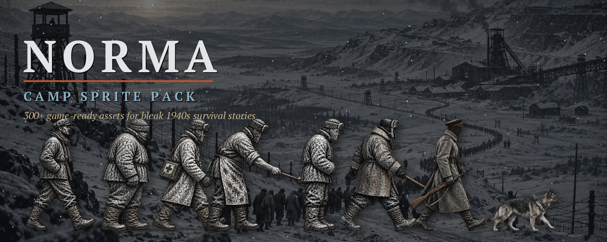
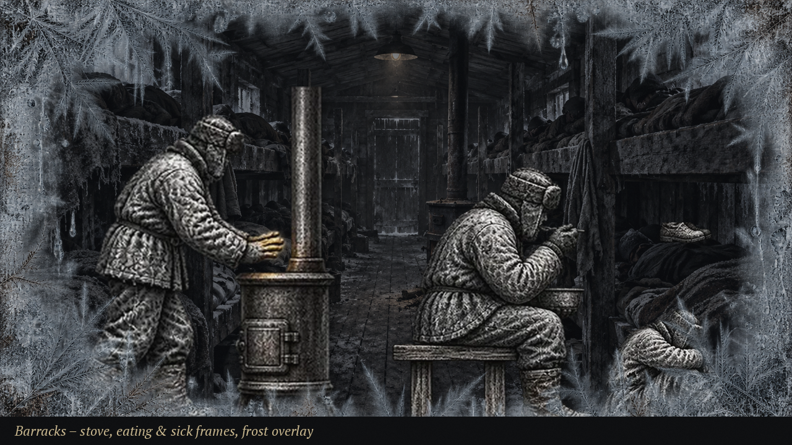
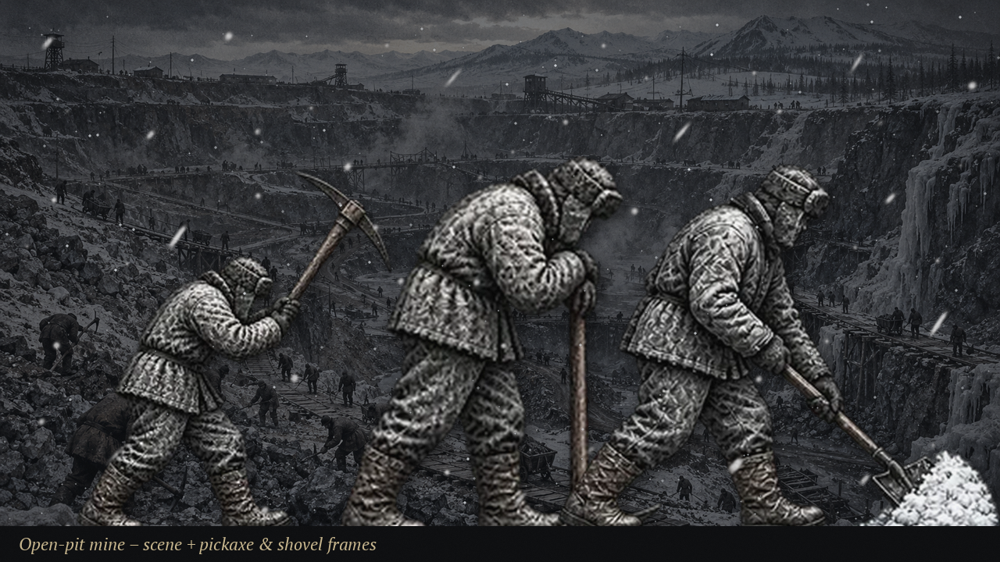
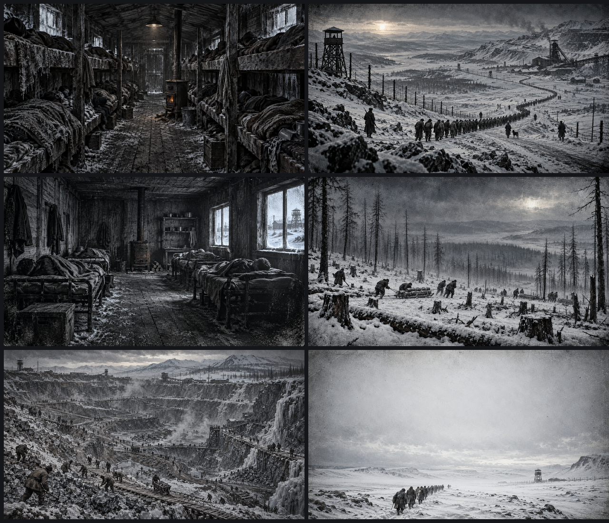
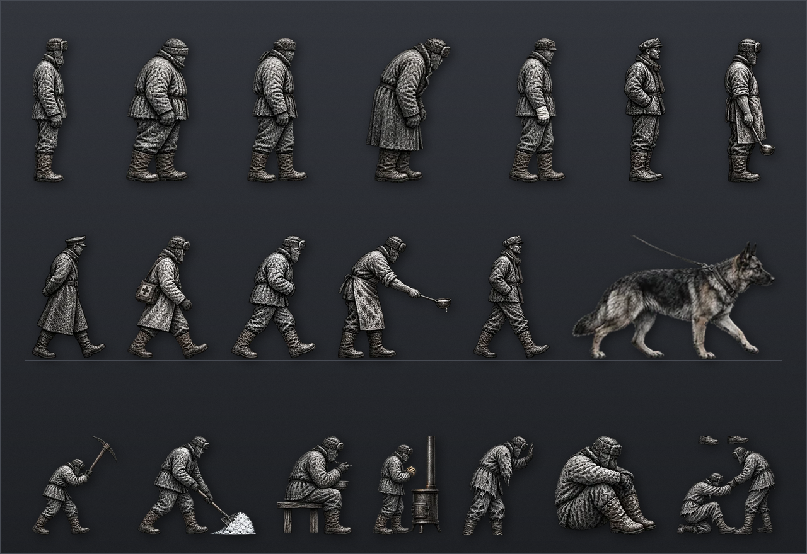
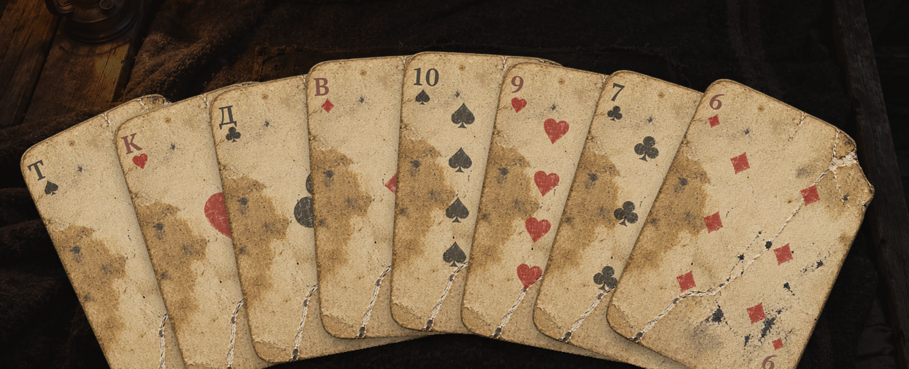
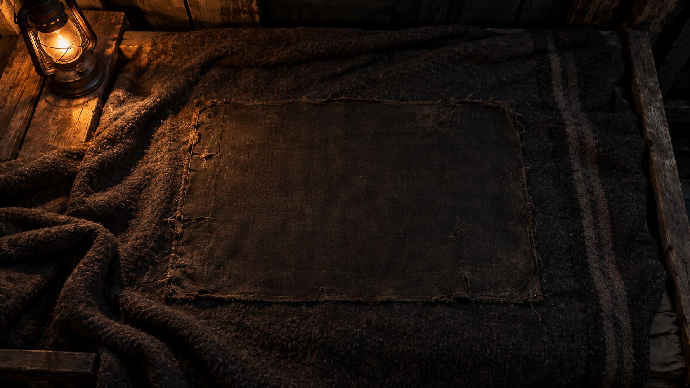
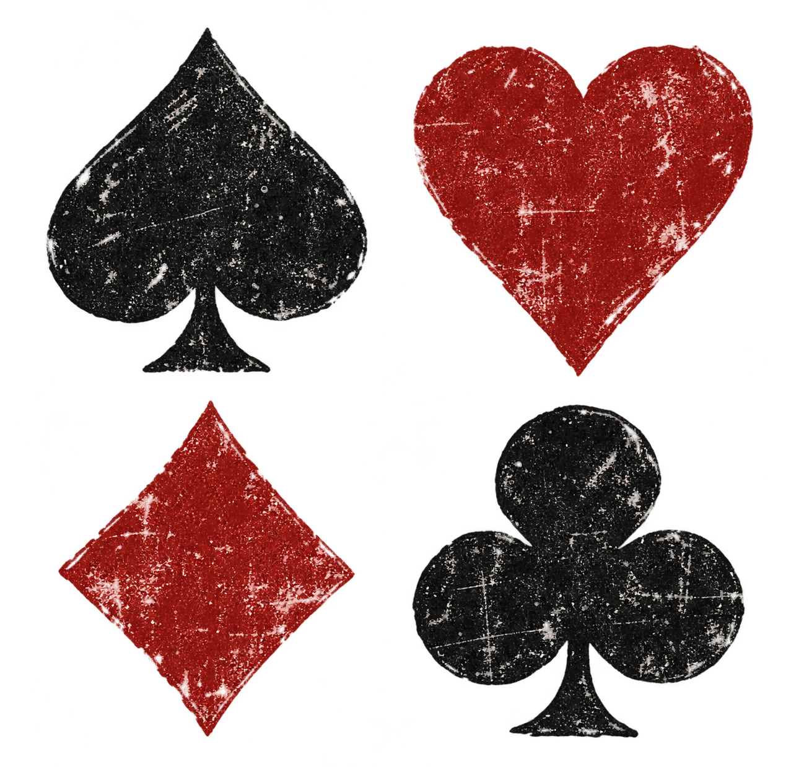
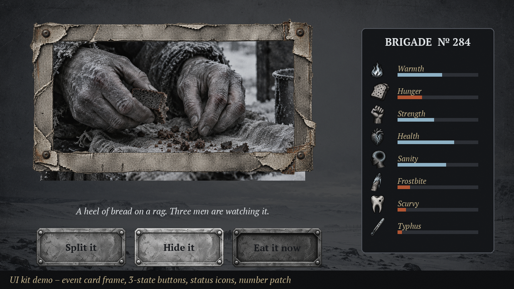

<p align="center">
  
</p>

<h1 align="center">НОРМА</h1>

<p align="center">
  Браузерная survival-игра о холоде, приказах и хрупкой человеческой памяти.<br>
  <a href="https://evgenibondarev.github.io/norma-survival/game/"><strong>Играть в браузере</strong></a>
  &nbsp;·&nbsp;
  <a href="https://evgenibondarev.itch.io/norma-camp-sprite-pack"><strong>Набор графики на itch.io</strong></a>
</p>

> Здесь нельзя строить команду и распоряжаться своей судьбой. Тебя ставят в строй, вызывают, обыскивают, записывают номер. Остаётся только прожить ещё один день — и не знать, какая мелочь вернётся к тебе через неделю.

<p align="center">
  
  
</p>

## О чём игра

`НОРМА` — повествовательная игра на выживание в лагерном быту. В ней нет правильной стратегии, которая делает человека неуязвимым: холод, голод, работа, долги, болезни и чужая память постепенно сужают пространство для жизни.

- Приказы и отметки назначаются извне: работа, место в строю, обыск или вызов нельзя отменить.
- Хлеб, одежда, тепло, махорка и информация не награда, а риск: ценная вещь привлекает внимание.
- Последствия не показываются цифрой. Вместо этого остаются следы: «номер записали отдельно», «Гаркунов видел тайник», «ботинок промок».
- Ночь в бараке — это несколько действий на выбор: лежать, греться у печи, сторожить хлеб или сесть за карты.

## Мир и графика

<p align="center">
  
  
  
</p>

Визуальный язык игры — уголь, сухая кисть, литографская штриховка и грубая бумага. Все игровые PNG-исходники, оптимизированные WebP-версии и промты для следующих иллюстраций находятся в репозитории.

Полный самостоятельный набор спрайтов, фонов, UI, карточных ассетов и анимаций доступен отдельно: **[NORMA Camp Sprite Pack на itch.io](https://evgenibondarev.itch.io/norma-camp-sprite-pack)**.

## Ночные карты

<p align="center">
  
  
</p>

В бараке можно сыграть с Наумовым в «очко» или упрощённого «дурака» на самодельной колоде из 36 карт. Проигрыш оставляет долг; рискнуть подменой карты — значит стать заметным. В «дураке» карты перетаскиваются на стол, Наумов отвечает на ход, а колода постепенно тает.

<p align="center">
  
</p>

## Запуск

Игра статическая: не требует Node.js, сборки или сервера приложений.

```bash
git clone https://github.com/EvgeniBondarev/norma-survival.git
cd norma-survival
python3 game/tools/serve.py
```

Откройте <http://localhost:8765/game/>. Для воспроизводимого прохождения можно указать seed:

```text
http://localhost:8765/game/?autostart&seed=123
```

## Проверки

```bash
node game/tools/coverage.mjs
node game/tools/determinism.mjs
node game/tools/simulate.mjs
```

## Структура проекта

| Папка | Назначение |
| --- | --- |
| `game/` | клиент игры, логика, интерфейс, звук и тестовые прогоны |
| `assets-webp/` | оптимизированные ресурсы, загружаемые браузером |
| `sprites/` | исходные изображения, карточная колода и промты новых серий |
| `reports/` | заметки о темах и игровых мотивах |

## Публикация

Игра развёрнута на [GitHub Pages](https://evgenibondarev.github.io/norma-survival/game/). Каждый push в `main` автоматически собирает и публикует `game/` вместе с `assets-webp/`.

## Источник тона

Игра опирается на художественную прозу Варлама Шаламова как на источник атмосферы и тем, но не пересказывает произведения буквально. Тексты, игровые ситуации и механики созданы для интерактивного формата.
