<p align="center">
  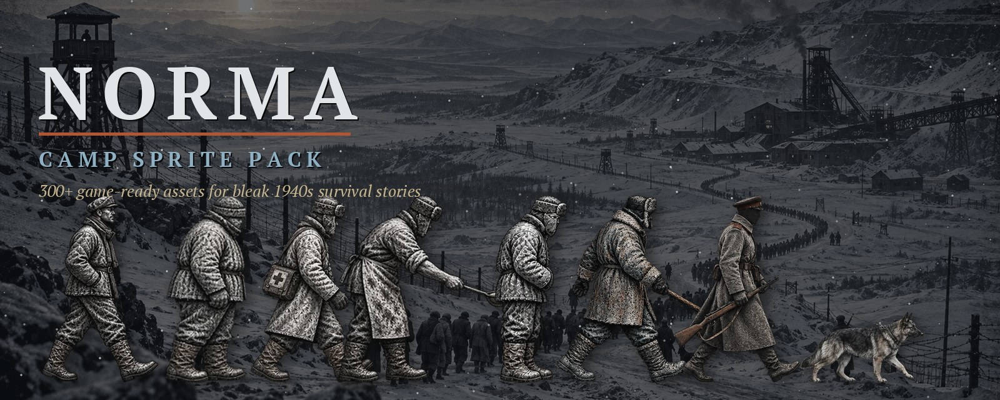
</p>

<h1 align="center">НОРМА · NORMA</h1>

<p align="center">
  Браузерная survival-игра о холоде, приказах и хрупкой человеческой памяти<br>
  <i>A bleak browser survival game and a gritty 1940s camp art pack</i>
</p>

<p align="center">
  <a href="https://evgenibondarev.github.io/norma-survival/game/"></a>
  <a href="https://evgenibondarev.itch.io/norma-camp-sprite-pack"></a>
  
</p>

<p align="center">
  <a href="#об-игре">Игра</a> ·
  <a href="#визуальный-стиль">Стиль</a> ·
  <a href="#спрайты-и-анимации">Спрайты</a> ·
  <a href="#фоны-и-параллакс">Фоны</a> ·
  <a href="#что-внутри-набора">Набор</a> ·
  <a href="#запуск">Запуск</a>
</p>

> Здесь нельзя строить команду и распоряжаться своей судьбой. Тебя ставят в строй, вызывают, обыскивают, записывают номер. Остаётся только прожить ещё один день — и не знать, какая мелочь вернётся к тебе через неделю.

<p align="center">
  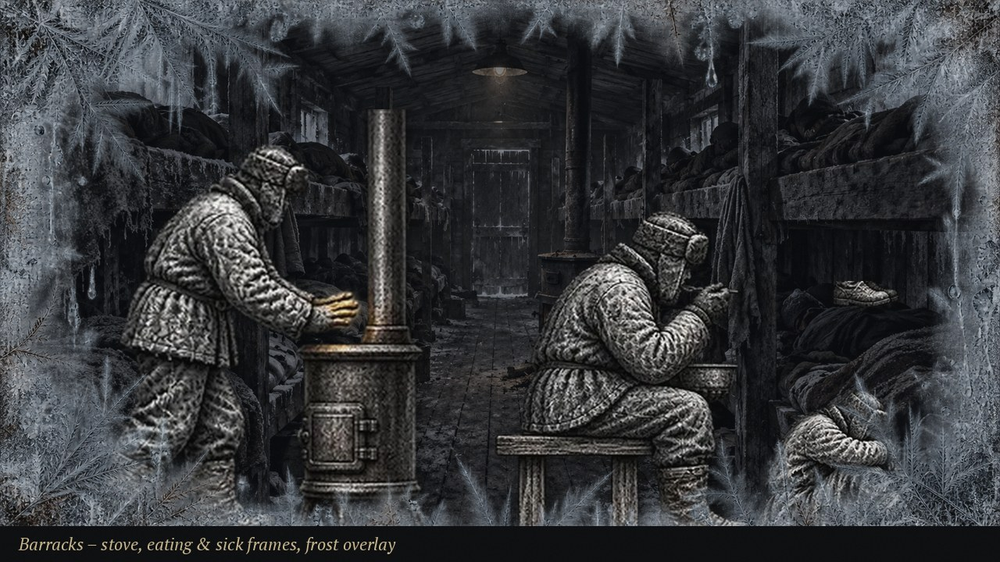
  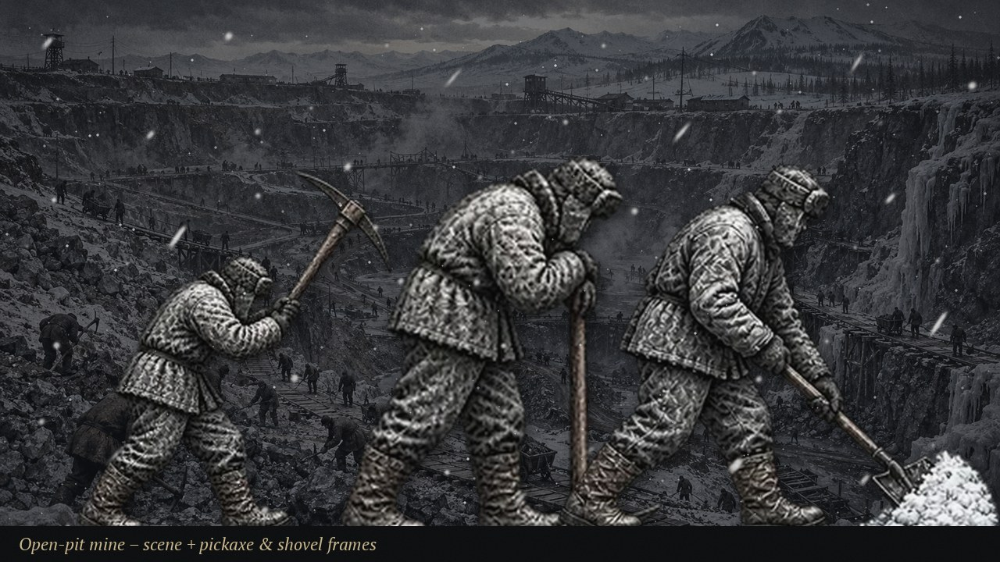
</p>

---

## Скачать графику · Get the art pack

Весь арт игры вынесен в отдельный бесплатный набор: **300+ файлов** — анимированные спрайты, предметы, интерфейс, фоны с параллаксом, погодные эффекты, иллюстрации и колода из 36 карт.

<p align="center">
  <a href="https://evgenibondarev.itch.io/norma-camp-sprite-pack">
    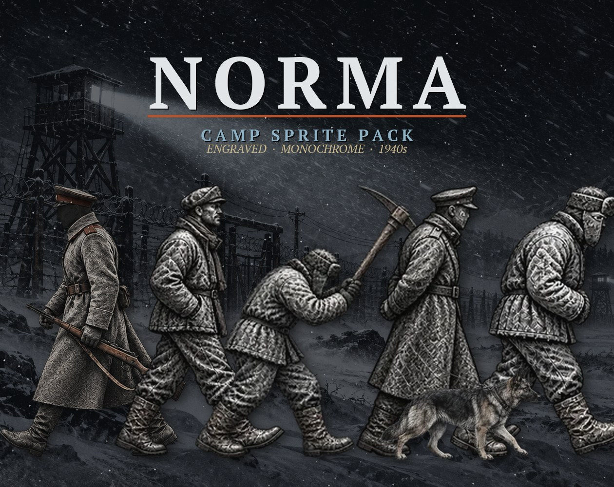
  </a>
  <br>
  <a href="https://evgenibondarev.itch.io/norma-camp-sprite-pack"><b>⬇ NORMA Camp Sprite Pack на itch.io</b></a>
</p>

| Архив | Что внутри | Размер |
| --- | --- | --- |
| **Complete Pack (PNG)** | все исходники без потерь, чистая раскладка по папкам + `08_Extras_and_Source` | ≈ 390 МБ |
| **Complete Pack (WebP)** | оригинальные браузерные WebP и JSON-атласы | ≈ 67 МБ |
| **Starter Frames (PNG)** | только отдельные прозрачные кадры, предметы и иконки | ≈ 14 МБ |

**English:** free for personal and commercial use, no redistribution or resale, no ML training. Credit is welcome but not required. All images were produced with generative AI tools and then cut, cleaned and packaged with scripts. Details in [`itch-release/LICENSE.txt`](itch-release/LICENSE.txt).

---

## Об игре

`НОРМА` — повествовательная игра на выживание в лагерном быту. В ней нет правильной стратегии, которая делает человека неуязвимым: холод, голод, работа, долги, болезни и чужая память постепенно сужают пространство для жизни.

- Приказы и отметки назначаются извне: работа, место в строю, обыск или вызов нельзя отменить.
- Хлеб, одежда, тепло, махорка и информация не награда, а риск: ценная вещь привлекает внимание.
- Последствия не показываются цифрой. Вместо этого остаются следы: «номер записали отдельно», «Гаркунов видел тайник», «ботинок промок».
- Ночь в бараке — это несколько действий на выбор: лежать, греться у печи, сторожить хлеб или сесть за карты.

<p align="center">
  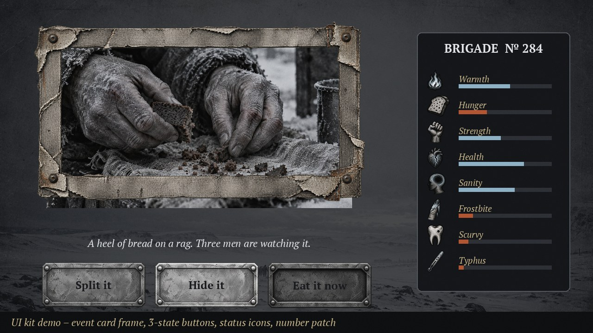
</p>

---

## Визуальный стиль

Уголь, сухая кисть, литографская и гравюрная штриховка на грубой бумаге. Лица почти целиком уходят в тень, свет цепляется за волосы и складки ватников. Всё приглушено: пепельно-серый, снежный белый, графит, чуть льдисто-голубого и редкие красно-бурые пятна.

| | | | | | |
| :---: | :---: | :---: | :---: | :---: | :---: |
|  |  |  |  |  |  |
| графит<br>`#14161a` | уголь<br>`#2a2d33` | пепел<br>`#8a9099` | снег<br>`#e8ecef` | лёд<br>`#8fb4c9` | ржавчина<br>`#b5532f` |

Принципы, которые держат арт вместе:

- **Силуэт важнее лица.** Персонажи безымянны, читаются по одежде и позе.
- **Один тёплый источник.** Самодельная лампа, печь или костёр — остальное холодное.
- **Шум как материал.** Зерно плёнки, иней по краям кадра, метель и дыхание живут отдельными слоями.
- **Воздух вокруг фигур.** Все спрайты вырезаны с прозрачным фоном и чистым краем, масштаб единый.
- **Свободное место под текст.** В сценах правая часть кадра остаётся тёмной и спокойной.

Шрифт интерфейса — PT Serif (файлы в [`game/fonts`](game/fonts)).

### Фон страницы и оформление

Тёмная тема страницы на itch.io собрана из тех же материалов: фон из ночной метели, баннер с колонной, обложка и разделители секций.

<p align="center">
  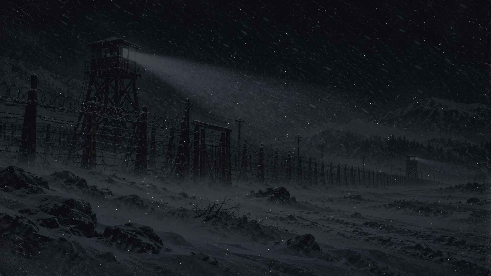
  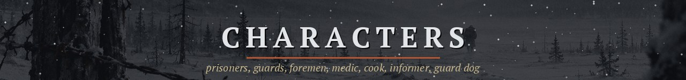
</p>

---

## Спрайты и анимации

Все кадры одного масштаба и выровнены по ногам (низ по центру), поэтому анимации можно смешивать. Скорость в прототипе — около 8 кадров в секунду.

<p align="center">
  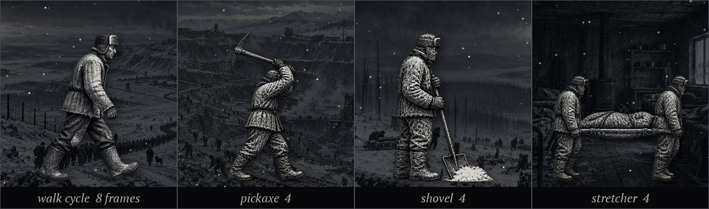
  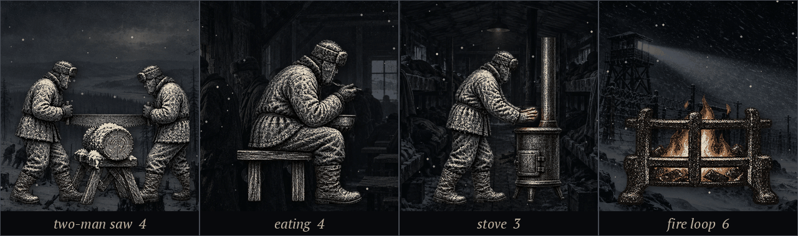
</p>

### Персонажи

<p align="center">
  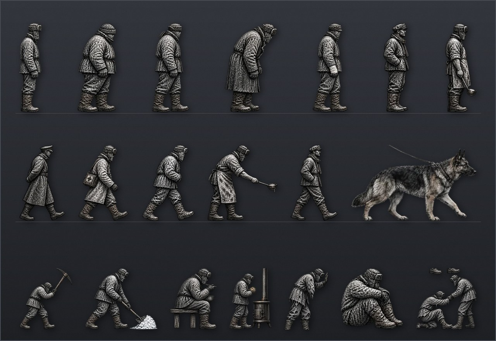
</p>

71 отдельный кадр: заключённые (5 силуэтов), начальник, повар, медик, стукач, уголовник, сторожевая собака. Листы анимаций: ходьба (8 кадров), кирка, лопата и двуручная пила, перекличка, еда, сон на нарах, печь, болезнь и обморок. Атласы 256×256 с JSON, два набора портретов 3×2.

### Предметы

<p align="center">
  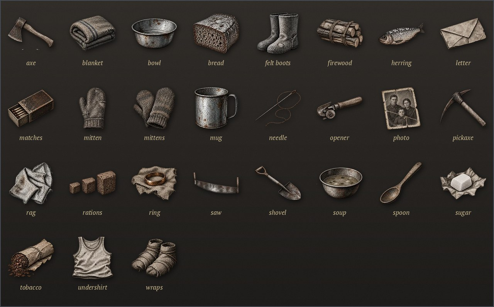
</p>

27 предметов отдельными PNG и три листа 3×3: хлеб, пайка, баланда, селёдка, сахар, махорка, спички, кружка, миска, ложка, валенки, варежки, портянки, одеяло, дрова, топор, пила, кирка, лопата, игла, кольцо, фото и письмо.

### Интерфейс

<p align="center">
  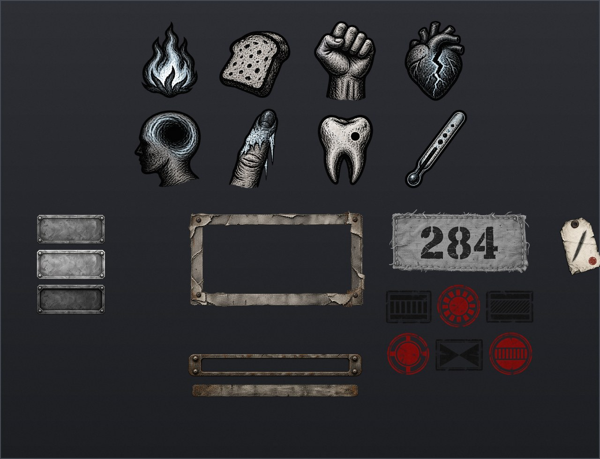
</p>

Восемь иконок состояний (тепло, голод, сила, здоровье, рассудок, обморожение, цинга, тиф), кнопки в трёх состояниях, рамка карточки события, шкала нормы, нашивка с номером, шесть штампов, бирка отметки, страницы учётной книги, курсор, логотип.

### Погода и эффекты

<p align="center">
  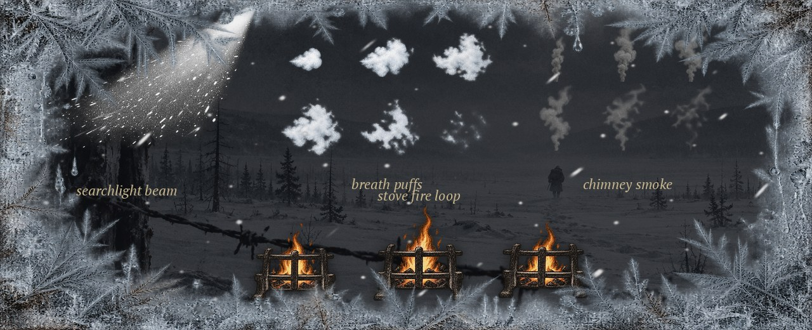
</p>

Снег, метель, иней по краям, зерно плёнки, старая бумага (бесшовные), виньетка голода, обморожение, затемнение смерти, луч прожектора, дыхание, дым из трубы и огонь печи.

---

## Фоны и параллакс

<p align="center">
  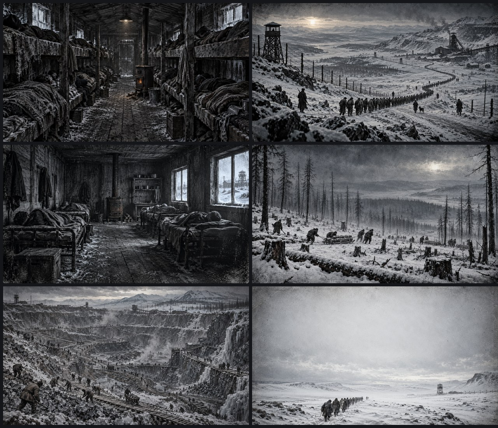
</p>

- **11 сцен** 1672×941: перекличка, марш, прииск, лесоповал, барак, баланда, метель, тайга за колючкой, лазарет, могильное поле, титульный снег.
- **7 локаций:** прибытие, проходная, карцер, баня, окно кухни, кабинет начальника, морг.
- **4 набора слоёв** (двор, шахта, лес, дорога): небо, дальний, средний и передний план для параллакса, плюс панорама марша 3840×1080.

<p align="center">
  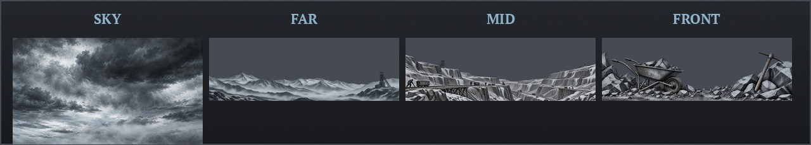
</p>

<p align="center">
  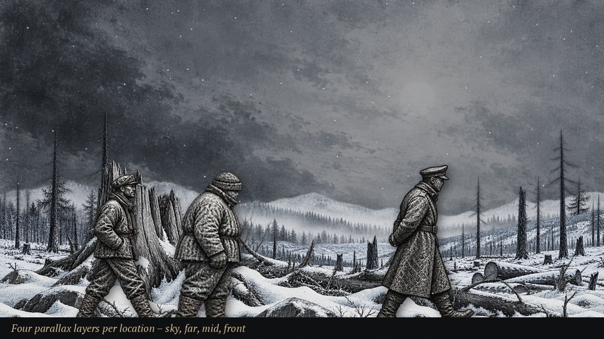
  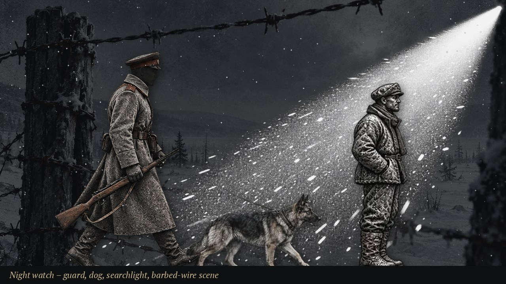
</p>
<p align="center">
  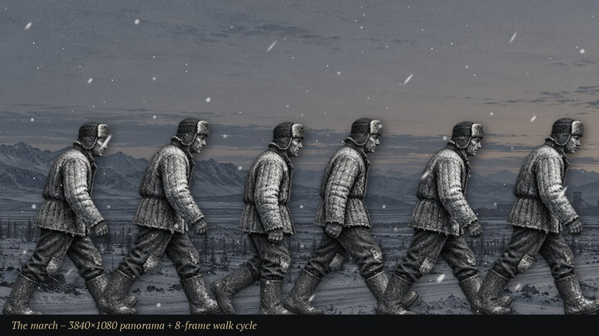
  
</p>

### Иллюстрации

<p align="center">
  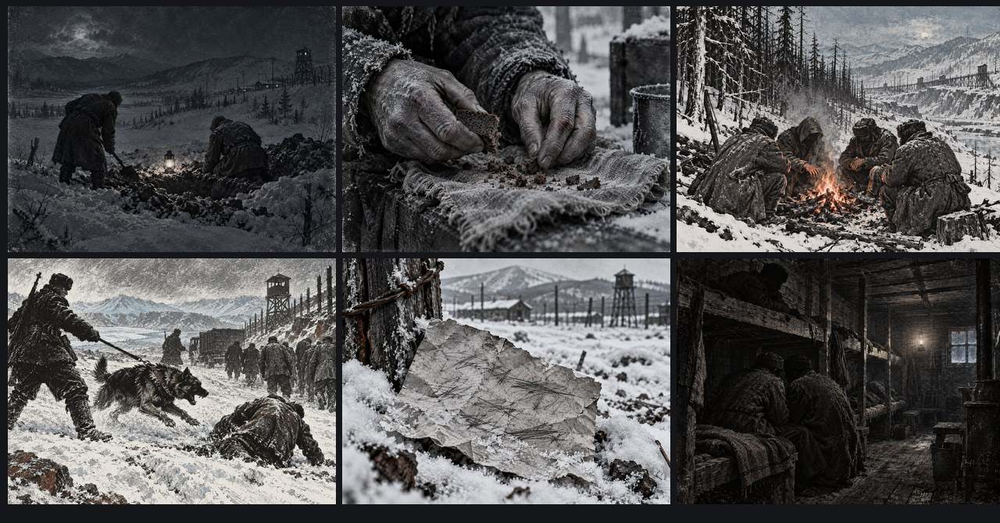
</p>

40 иллюстраций для событий, быта и сюжета: ночная работа, хлеб на тряпке, руки в обмотках, костёр, нападение собаки, найденная записка, посылка, две концовки.

### Ночные карты

<p align="center">
  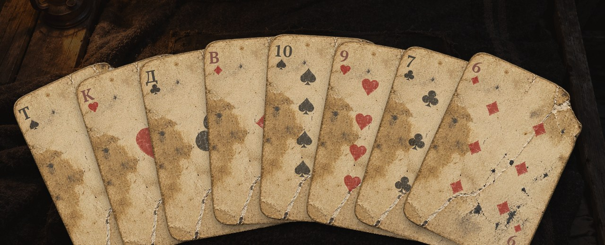
</p>

Колода из 36 потёртых карт (от шестёрки до туза, четыре масти), рубашка, пустая карта, масти и сцена карточного стола. В бараке можно сыграть с Наумовым в «очко» или упрощённого «дурака»: проигрыш оставляет долг, подмена карты делает тебя заметным.

---

## Что внутри набора

```text
NORMA_Camp_Sprite_Pack/
├── 01_Characters/          sheets · atlases_256 · frames (71) · portraits
├── 02_Items/               sheets + single (27)
├── 03_UI/                  icons · buttons · frames · stamps · ledger · logo · single
├── 04_Backgrounds/         scenes (11) · locations (7) · parallax · parallax_layers
├── 05_Effects_and_Overlays/ particles · overlays · textures
├── 06_Illustrations/       events · camp_life · story
├── 07_Playing_Cards/       deck_36 · extras
├── 08_Extras_and_Source/   всё остальное из исходников по прежним путям
├── README.txt
└── LICENSE.txt
```

Сборщик набора лежит в [`itch-release/`](itch-release): [`build_pack.py`](itch-release/build_pack.py) раскладывает файлы и проверяет по SHA-256, что из `sprites/` ничего не потеряно; остальные скрипты рисуют обложку, баннер, GIF и скриншоты страницы. Готовые архивы в Git не хранятся (слишком большие) и лежат на [itch.io](https://evgenibondarev.itch.io/norma-camp-sprite-pack).

---

## Запуск

Игра статическая: не требует Node.js, сборки или сервера приложений.

```bash
git clone https://github.com/EvgeniBondarev/norma-survival.git
cd norma-survival
python3 game/tools/serve.py
```

Откройте <http://localhost:8765/game/>. Для воспроизводимого прохождения можно указать seed:

```text
http://localhost:8765/game/?autostart&seed=123
```

### Проверки

```bash
node game/tools/coverage.mjs
node game/tools/determinism.mjs
node game/tools/simulate.mjs
```

### Структура проекта

| Папка | Назначение |
| --- | --- |
| `game/` | клиент игры, логика, интерфейс, звук и тестовые прогоны |
| `assets-webp/` | оптимизированные ресурсы, загружаемые браузером |
| `sprites/` | исходные изображения, карточная колода и промты серий |
| `itch-release/` | сборка набора для itch.io и оформление страницы |
| `reports/`, `research_notes/` | заметки о темах и игровых мотивах |

### Публикация

Игра развёрнута на [GitHub Pages](https://evgenibondarev.github.io/norma-survival/game/). Каждый push в `main` автоматически собирает и публикует `game/` вместе с `assets-webp/`.

---

## Источник тона и этика

Игра опирается на художественную прозу Варлама Шаламова как на источник атмосферы и тем, но не пересказывает произведения буквально. Тексты, игровые ситуации и механики созданы для интерактивного формата. Лагеря 1940-х показаны как серьёзная историческая тема: пожалуйста, используйте арт с уважением к жертвам политических репрессий.

## Лицензия на графику

Личное и коммерческое использование, правки и перекраска разрешены. Нельзя перепродавать и перераспространять ассеты, а также обучать на них модели. Упоминание приветствуется: *Art: NORMA Camp Sprite Pack by EvgeniBondarev*. Все изображения созданы с помощью генеративного ИИ и затем нарезаны и собраны скриптами.

<p align="center">
  <a href="https://evgenibondarev.itch.io/norma-camp-sprite-pack"><b>evgenibondarev.itch.io/norma-camp-sprite-pack</b></a>
</p>
